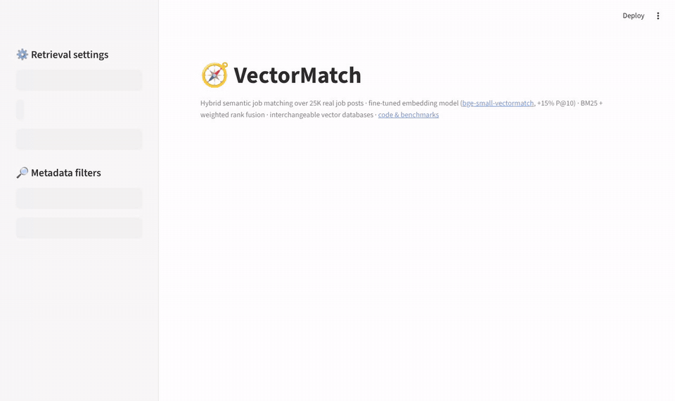
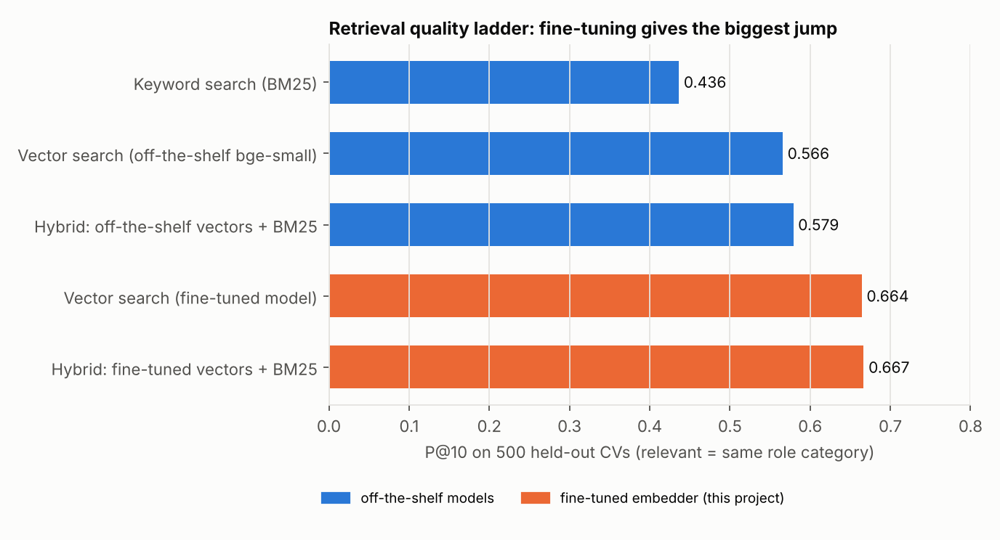
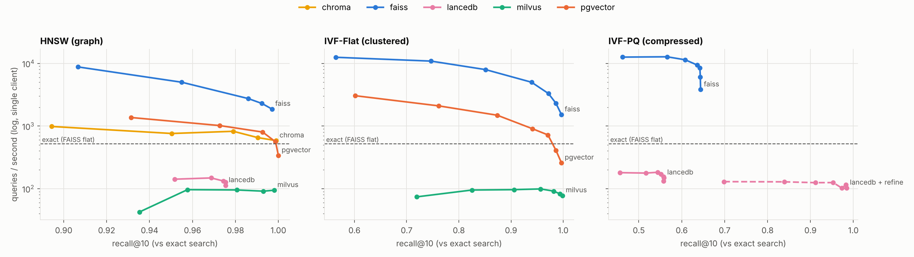
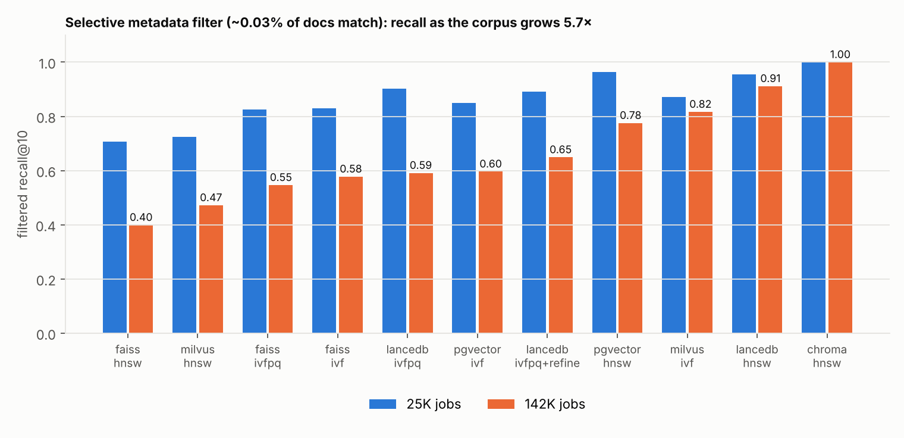
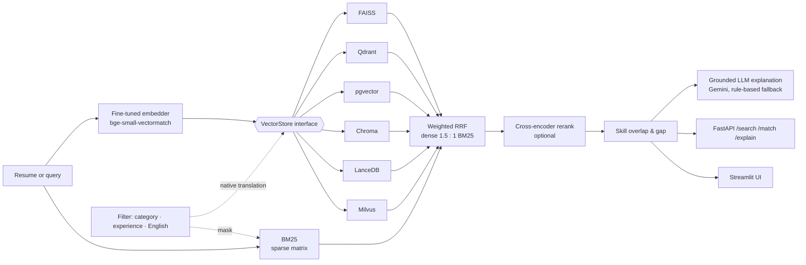

<div align="center">

# 🧭 VectorMatch

### Hybrid semantic job matching, with six vector databases benchmarked head to head on real data

[](https://github.com/KhajaRaheelAhmedMohiuddin/vectormatch/actions/workflows/ci.yml)


[](LICENSE)

**[🤗 Fine-tuned model](https://huggingface.co/KhajaHugging/bge-small-vectormatch) · [Results](#-results-at-a-glance) · [Architecture](#-architecture) · [Quick start](#-quick-start) · [Full benchmarks](docs/BENCHMARKS.md) · [Design decisions](docs/ARCHITECTURE.md)**



</div>

---

Paste a resume and VectorMatch returns ranked, explainable job matches from **25,000 real job posts**, plus a report of the skills those jobs ask for that the resume doesn't show.

Retrieval runs on an embedding model **fine-tuned for CV→job matching** ([`bge-small-vectormatch`](https://huggingface.co/KhajaHugging/bge-small-vectormatch)), fused with BM25. Under the hood, one `VectorStore` interface runs identical data through **FAISS, Qdrant, pgvector, Chroma, LanceDB and Milvus**. Every engine passes the same contract tests and is measured by the same harness, so questions like *"pgvector or Qdrant?"*, *"what does product quantisation cost?"* and *"is fine-tuning worth it?"* get answered with numbers.

## ✨ Results at a glance

| | Result |
|---|---|
| 🧠 **Fine-tuned embedder** | Contrastive fine-tuning with BM25 hard negatives and category-aware masking: **+15% P@10** over the best off-the-shelf system and **+53% over keyword search** (0.436 → 0.667, held-out test split) |
| 🎯 **Honest evaluation** | 1,000 real CVs, dev/test split, leak-free training data (asserted disjoint); negative results reported too (naive hybrid fusion and rerankers did *not* help) |
| ⚡ **Throughput** | **5,000 QPS at 0.955 recall@10** with FAISS HNSW, ~10× exact search |
| 🐘 **pgvector** | **~1 ms p50 at 0.97 recall**, inside plain PostgreSQL |
| 🗜️ **Compression** | IVF-PQ index **17.5× smaller**; full-vector refine restores recall from 0.56 to **0.98** |
| 🔍 **Filtered search** | Under selective filters, HNSW returned **fewer than k results on 40%** of queries in two engines, worsening to **65% at 142K** vectors; pre-filtering engines stayed accurate. pgvector's planner switches between HNSW and exact scans based on the *indexed* predicate only (`EXPLAIN` verified) |
| 📈 **Scale** | Re-run on all **141,846** jobs: exact search slowed 10.6×, HNSW stayed sub-millisecond (0.38 ms at 0.955 recall), and its edge over exact search grew from **11× to 53×** |
| 🚀 **Engineering** | BM25 rewritten as a sparse matrix: **640× faster** (505 → 0.8 ms) with identical scores; resume match end to end **115 ms p50** |

<p align="center"></p>

<p align="center"></p>

<p align="center"></p>

<details>
<summary><b>Retrieval quality table</b> (500 held-out CVs → 25K jobs, relevance = same role category)</summary>

| Method | Model | P@10 | nDCG@10 | MRR | Hit@1 |
|---|---|---:|---:|---:|---:|
| BM25 (keyword) | – | 0.436 | 0.439 | 0.575 | 0.444 |
| Dense (vector) | bge-small-en-v1.5 | 0.566 | 0.570 | 0.695 | 0.598 |
| Hybrid RRF, dense weight 2 (dev-tuned) | bge-small-en-v1.5 | 0.579 | 0.581 | 0.698 | 0.596 |
| Dense (vector) | **bge-small-vectormatch** | 0.664 | 0.661 | 0.740 | 0.642 |
| Hybrid RRF, equal weights | bge-small-vectormatch | 0.616 | 0.626 | 0.746 | 0.654 |
| **Hybrid RRF, dense weight 1.5 (dev-tuned)** | **bge-small-vectormatch** | **0.667** | **0.667** | **0.755** | **0.666** |
| + cross-encoder rerank (off-the-shelf / fine-tuned) | bge-small-vectormatch | 0.665 / 0.669 | 0.668 / 0.668 | 0.767 / 0.758 | 0.676 / 0.662 |

Equal-weight fusion is *worse* than dense alone; weighting the stronger retriever fixes it. Once the embedder is fine-tuned, rerankers (even one fine-tuned on the same data) add nothing measurable for ~750 ms/query, so reranking is off by default.
</details>

<details>
<summary><b>Fastest configuration per engine at recall@10 ≥ 0.95</b></summary>

| Engine / index | Setting | Recall@10 | p50 | QPS | Index size |
|---|---|---:|---:|---:|---:|
| FAISS HNSW | ef_search=32 | 0.955 | 0.17 ms | 5,000 | 42 MB |
| FAISS IVF-Flat | nprobe=16 | 0.972 | 0.29 ms | 3,304 | 39 MB |
| pgvector HNSW | ef_search=32 | 0.973 | 0.96 ms | 1,017 | 93 MB |
| Chroma HNSW | ef_search=64 | 0.979 | 1.20 ms | 823 | – |
| LanceDB IVF-HNSW-SQ | ef=32 | 0.969 | 6.6 ms | 148 | 52 MB |
| Milvus Lite HNSW | ef=32 | 0.958 | 10.1 ms | 96 | 39 MB |

Qdrant was measured in embedded mode (exact search only); see [limitations](#-limitations).
</details>

➡️ **Methodology, fine-tuning details, all tables, filtered-search analysis and query plans: [docs/BENCHMARKS.md](docs/BENCHMARKS.md)**

## 🗄️ Supported vector databases

| Engine | Runs as | Indexes benchmarked | Metadata filter becomes |
|---|---|---|---|
| **FAISS** | in-process library | Flat · HNSW · IVF-Flat · IVF-PQ | `IDSelectorBatch` (filter during search) |
| **Qdrant** | embedded / server (`QDRANT_URL`) | Flat (embedded) · HNSW (server) | `models.Filter(must=[FieldCondition…])` |
| **pgvector** | PostgreSQL extension | Exact · HNSW · IVFFlat | SQL `WHERE` + B-tree index |
| **Chroma** | embedded | HNSW | `where={"$and": [...]}` |
| **LanceDB** | embedded, Lance files (disk/S3) | Exact · IVF-PQ (+refine) · IVF-HNSW-SQ | SQL predicate, pre-filter |
| **Milvus** | Milvus Lite (same API as cluster) | FLAT · HNSW · IVF_FLAT · IVF_PQ | boolean expression |

Switching engines is one word: `VM_BACKEND=pgvector make api`, or `"backend": "pgvector"` per request.

## 🏗️ Architecture



Design rationale (why one interface, why real CV queries, why rank fusion, why filters are first-class): **[docs/ARCHITECTURE.md](docs/ARCHITECTURE.md)**

## 🚀 Quick start

```bash
git clone https://github.com/KhajaRaheelAhmedMohiuddin/vectormatch && cd vectormatch
python -m venv .venv && source .venv/bin/activate
make install   # pinned deps + package
make data      # download dataset, embed 25K jobs + 1K CVs (~25 min on 4 CPUs)
make ui        # http://localhost:8501 (uses the fine-tuned model from the Hugging Face Hub)
```

Full stack with real Qdrant and PostgreSQL/pgvector servers:

```bash
docker compose up --build   # API :8000 · UI :8501 · Qdrant :6333 · Postgres :5432
```

Run `make help` for every task (`eval`, `bench`, `charts`, `test`, `api`, …).

### Deploy the demo (free)

**Streamlit Community Cloud:** at [share.streamlit.io](https://share.streamlit.io) choose **Create app** → this repo, branch `main`, main file `deploy/streamlit/streamlit_app.py`, Python 3.12. On first start the app downloads the checksummed data bundle (25K jobs + fine-tuned embeddings) from the [`release-assets`](https://github.com/KhajaRaheelAhmedMohiuddin/vectormatch/tree/release-assets) branch and the model from the Hugging Face Hub; it is ready in under a minute. CI runs this exact setup headlessly (CPU-only PyTorch, real data, a UI click and a memory budget) on every push.

**Hugging Face Spaces:** `python hub/publish.py` publishes the model and a Gradio Space (`space/app.py`).

### API example

```bash
curl -s localhost:8000/match -H 'content-type: application/json' -d '{
  "resume": "AI engineer: Python, PyTorch, LangChain, RAG, FastAPI, Docker ...",
  "k": 5,
  "backend": "pgvector",
  "filters": {"max_exp_years": 3, "categories": ["Python", "Data Science"]}
}'
```

Each result includes its rank in the dense and BM25 lists, matched and missing skills, and an aggregate skill-gap report. Interactive docs are at `localhost:8000/docs`. Set `GEMINI_API_KEY` to enable grounded LLM explanations on `/explain`; without it, a deterministic explanation is returned.

## 🧪 Testing & quality

- **Contract tests**: every backend must equal brute-force search for exact indexes, reach ≥ 0.9 recall for ANN indexes, and never return a document that violates a filter.
- **Parity test**: the sparse BM25 must match the reference `rank_bm25` scores.
- **Unit, API and UI tests**: hybrid modes, filters, rerank, data pipeline, embedding cache, model resolution and fallback, LLM fallback, FastAPI routes and a headless Streamlit render.
- **Leakage guard**: the training-set builder asserts zero overlap with evaluation CVs and the search corpus.
- **CI** on Python 3.12 and 3.13 against a real `pgvector/pgvector:pg16` service, plus ruff and a Docker build. 45 tests, 86% line coverage.

```bash
make test   # pgvector tests run when PG_DSN points at Postgres + pgvector, else they are skipped
```

## 📁 Project structure

```
vectormatch/
├── stores/          one adapter per engine behind base.VectorStore (+ Filter, IndexConfig)
├── engine.py        hybrid retrieval, filters, rerank, resume matching
├── embeddings.py    sentence-transformers, normalised, cached to .npy; fine-tuned model with base fallback
├── sparse.py        BM25 as a precomputed sparse matrix
├── fusion.py        weighted Reciprocal Rank Fusion
├── rerank.py        cross-encoder
├── skills.py        110 skills / ~200 aliases, skill-gap analysis
├── llm.py           optional grounded explanation (versioned prompt)
└── eval/metrics.py  P@k, nDCG, MRR, recall@k, latency percentiles
api/                 FastAPI service
ui/                  Streamlit app
scripts/             prepare_data · build_training_set · finetune_embedder · finetune_reranker ·
                     eval_quality · benchmark_ann · make_charts · build_space
space/               Gradio app for the Hugging Face Space (live demo)
hub/                 model card for the published embedder
benchmarks/results/  every number in the docs, as CSV/JSON
tests/               contract · unit · API · UI tests
```

## ⚠️ Limitations

- **Relevance is a proxy.** A "Python" CV can legitimately fit a "Data Science" job, so absolute P@10 is conservative. The relative ordering of methods is the signal.
- **Scale and hardware.** Results are for 25K and 142K vectors on a 4-vCPU VM with a single client. Client/server engines pay protocol overhead that in-process FAISS does not, and Milvus Lite is the embedded development build, not a Milvus cluster.
- **Qdrant** was benchmarked in embedded mode, which is exact search only (and left out of the 142K run). Its HNSW numbers need the server (`docker compose up`, then `QDRANT_URL=http://localhost:6333 make bench`).

## 🗺️ Roadmap

- [x] Fine-tune the embedder on CV→job pairs with BM25 hard negatives (+15% P@10)
- [x] Fine-tune the cross-encoder (measured: no gain once the retriever is fine-tuned)
- [x] Scale benchmark to the full ~142K-job corpus
- [ ] Qdrant server, Pinecone and Weaviate adapters; pgvector 0.8 iterative scans for filtered HNSW
- [ ] 1M+ vectors and multi-threaded throughput; Matryoshka / int8 embeddings for memory
- [ ] Multi-vector job representation (title / requirements / responsibilities)

## 📜 License & acknowledgements

MIT © Khaja Raheel Ahmed Mohiuddin. See [LICENSE](LICENSE).
Data: [Djinni recruitment dataset](https://huggingface.co/datasets/lang-uk/recruitment-dataset-job-descriptions-english) by lang-uk (MIT). Models: [BAAI/bge-small-en-v1.5](https://huggingface.co/BAAI/bge-small-en-v1.5), [all-MiniLM-L6-v2](https://huggingface.co/sentence-transformers/all-MiniLM-L6-v2), [ms-marco-MiniLM-L-6-v2](https://huggingface.co/cross-encoder/ms-marco-MiniLM-L-6-v2).
