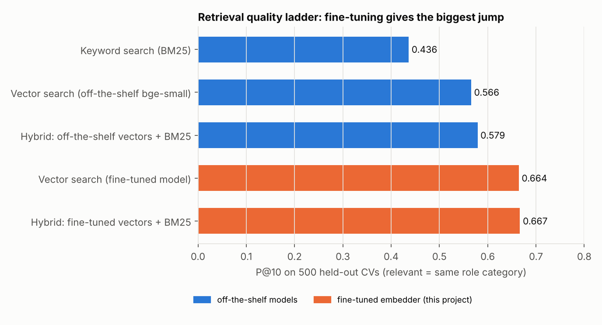
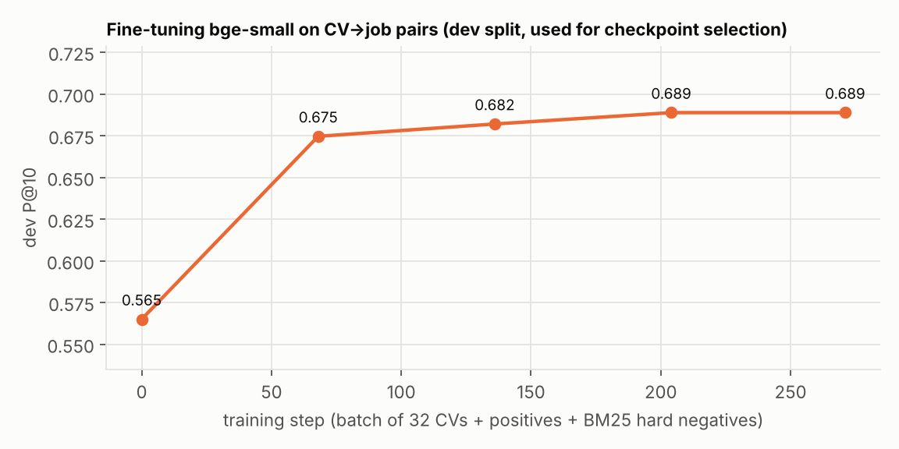
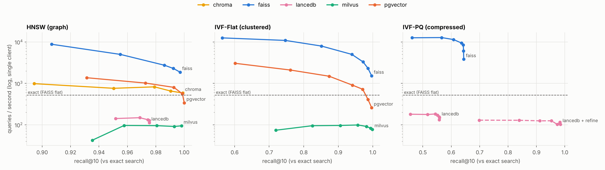
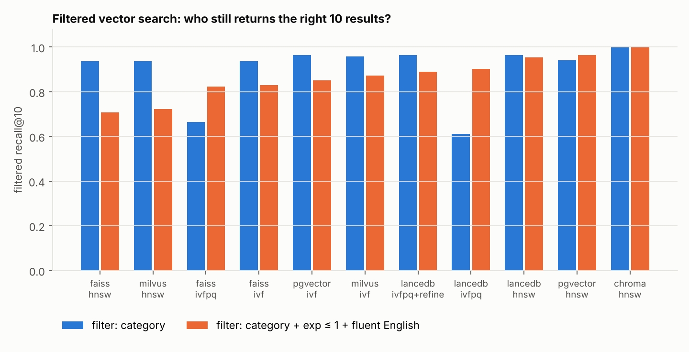
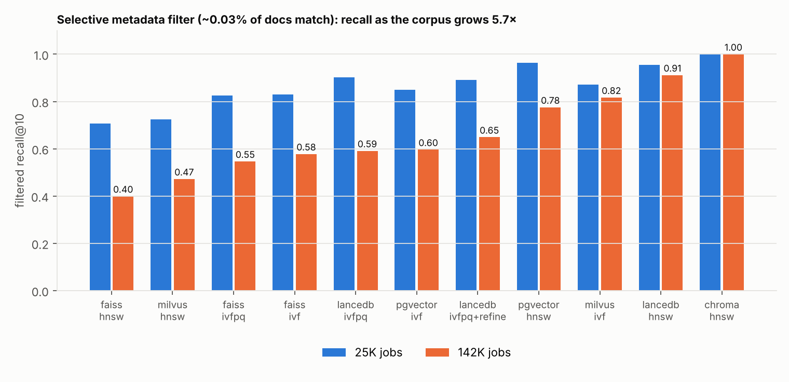

# Benchmarks & methodology

Every number here is produced by scripts in this repo and stored as CSV/JSON in [`benchmarks/results/`](../benchmarks/results).
Reproduce everything with:

```bash
make data      # download + embed (bge-small, MiniLM)
make finetune  # leak-free training set + fine-tune the embedder (~3.5 h on 4 CPUs)
make eval      # retrieval quality  -> benchmarks/results/quality*.csv
make bench     # ANN + filtered ANN -> benchmarks/results/ann*.csv
make charts    # -> docs/img/*.png
```

## Setup

| | |
|---|---|
| Corpus | 24,999 job posts, stratified sample across 41 categories of the [Djinni dataset](https://huggingface.co/datasets/lang-uk/recruitment-dataset-job-descriptions-english) (MIT) |
| Queries | 1,000 real candidate CVs ([companion dataset](https://huggingface.co/datasets/lang-uk/recruitment-dataset-candidate-profiles-english)), 25 per category, 40 categories ("Other" excluded) |
| Relevance | `job.category == candidate.category`, labels from the dataset itself (no LLM grading) |
| Protocol | 50/50 dev/test split of the queries. Hyperparameters (fusion weight) tuned on dev, all reported numbers on test |
| Embeddings | `BAAI/bge-small-en-v1.5`, `sentence-transformers/all-MiniLM-L6-v2` and the fine-tuned [`bge-small-vectormatch`](https://huggingface.co/KhajaHugging/bge-small-vectormatch) (384-d, L2-normalised, max 256 tokens). ANN benchmarks use MiniLM vectors. |
| ANN ground truth | Exact inner-product top-10 (numpy); queries are CV embeddings, not corpus samples |
| Hardware | 4 vCPU x86_64 cloud VM, Python 3.13, single client, sequential queries, FAISS OMP threads = 1 |
| Versions | FAISS 1.16 · qdrant-client 1.20 (embedded) · pgvector 0.6 on PostgreSQL 16 · Chroma 1.5 · LanceDB 0.41 · Milvus Lite 3.2 |


## 1. Retrieval quality: does a candidate's CV retrieve jobs in their own field?

Both CVs and jobs carry the dataset's own `Primary Keyword` label (Python, DevOps, QA, …), so relevance is objective rather than graded by an LLM. The 1,000 CVs are split 50/50: fusion weights and fine-tuning checkpoints are chosen on **dev**, and every number below is on the held-out **test** half.



| Method | Model | P@10 | nDCG@10 | MRR | Hit@1 |
|---|---|---:|---:|---:|---:|
| BM25 (keyword) | – | 0.436 | 0.439 | 0.575 | 0.444 |
| Dense (vector) | all-MiniLM-L6-v2 | 0.561 | 0.565 | 0.681 | 0.586 |
| Dense (vector) | bge-small-en-v1.5 | 0.566 | 0.570 | 0.695 | 0.598 |
| Hybrid RRF, equal weights | bge-small-en-v1.5 | 0.561 | 0.566 | 0.692 | 0.590 |
| Hybrid RRF, dense weight 2 (dev-tuned) | bge-small-en-v1.5 | 0.579 | 0.581 | 0.698 | 0.596 |
| Dense (vector) | **bge-small-vectormatch (fine-tuned)** | 0.664 | 0.661 | 0.740 | 0.642 |
| Hybrid RRF, equal weights | bge-small-vectormatch | 0.616 | 0.626 | 0.746 | 0.654 |
| **Hybrid RRF, dense weight 1.5 (dev-tuned)** | **bge-small-vectormatch** | **0.667** | **0.667** | **0.755** | **0.666** |
| + off-the-shelf cross-encoder rerank (top-20) | bge-small-vectormatch | 0.665 | 0.668 | 0.767 | 0.676 |
| + fine-tuned cross-encoder rerank (top-20) | bge-small-vectormatch | 0.669 | 0.668 | 0.758 | 0.662 |

**Findings**
* **Fine-tuning the embedder is the biggest single gain: +15% relative P@10** over the best off-the-shelf system (0.579 → 0.667), and **+53% over keyword search**. The fine-tuned model *alone* (0.664) beats every off-the-shelf configuration, hybrid included, at the same size and latency.
* **Naive hybrid search can hurt.** Equal-weight RRF is *worse* than dense alone for every model, because BM25 is much weaker on long, noisy CVs. A dev-tuned weight (2:1 base, 1.5:1 fine-tuned) makes hybrid the best method. See the sweep in [`quality_fusion_sweep.csv`](../benchmarks/results/quality_fusion_sweep.csv).
* **Rerankers stop paying off once the retriever is fine-tuned.** Both the off-the-shelf MS-MARCO cross-encoder and one fine-tuned on the same CV→job triples land within ±0.01 P@10 of no reranking, at ~750 ms/query on CPU. Reranking is therefore off by default; it slightly improves top-1 (Hit@1 0.666 → 0.676) when that matters more than latency.

### How the embedder was fine-tuned



| | |
|---|---|
| Training data | 8,702 (CV, same-category job, hard-negative job) triples built by [`scripts/build_training_set.py`](../scripts/build_training_set.py) from 182K unused CVs and 110K unused jobs. The script **asserts** zero overlap (by id and exact text) with the evaluation CVs and the search corpus. |
| Hard negatives | For each CV, the top BM25-ranked job from a *different* category: lexically similar, wrong role. |
| Loss | InfoNCE (τ = 0.05) over in-batch + hard negatives, with **category-aware false-negative masking**: other in-batch jobs of the CV's own category are correct matches, so their logits are masked instead of being pushed away. |
| Optimisation | 1 epoch, batch 32 CVs (96 texts/step), AdamW lr 2e-5, 10% warm-up, linear decay, 256 tokens. |
| Memory | SDPA attention + gradient checkpointing: peak RAM **14 GB → 3.9 GB**, so it trains on a 4-vCPU CPU machine (3.3 h). |
| Selection | Best checkpoint on dev (P@10 0.565 → 0.689), then a single test run. |

The reranker was fine-tuned the same way ([`scripts/finetune_reranker.py`](../scripts/finetune_reranker.py), BCE on positives, BM25 hard negatives and in-batch negatives). Dev P@10 plateaued at 0.708 vs 0.701 for the base model, so training was stopped at step 190 of 271 ([log](../benchmarks/results/finetune_reranker_log.json)).

## 2. ANN benchmark: six vector databases, same 25K × 384-d vectors

Queries are **real CV embeddings**, not vectors sampled from the corpus, so recall is not inflated. The ground truth is exact top-10.



Fastest configuration per engine that reaches **recall@10 ≥ 0.95**:

| Engine / index | Setting | Recall@10 | p50 | p95 | QPS | Build | Size |
|---|---|---:|---:|---:|---:|---:|---:|
| FAISS HNSW (M=16) | ef_search=32 | 0.955 | 0.17 ms | 0.37 ms | 5,000 | 5.2 s | 42 MB |
| FAISS IVF-Flat (256 lists) | nprobe=16 | 0.972 | 0.29 ms | 0.41 ms | 3,304 | 1.8 s | 39 MB |
| pgvector HNSW (M=16) | ef_search=32 | 0.973 | 0.96 ms | 1.37 ms | 1,017 | 5.2 s | 93 MB |
| Chroma HNSW (M=16) | ef_search=64 | 0.979 | 1.20 ms | 1.52 ms | 823 | 8.5 s | – |
| pgvector IVFFlat (256 lists) | probes=16 | 0.971 | 1.36 ms | 1.80 ms | 721 | 2.1 s | 85 MB |
| LanceDB IVF-HNSW-SQ | ef=32 | 0.969 | 6.6 ms | 8.3 ms | 148 | 2.0 s | 52 MB |
| LanceDB IVF-PQ **+ refine×10** | nprobe=8 | 0.953 | 7.8 ms | 9.6 ms | 125 | 6.9 s | 40 MB |
| Milvus Lite IVF-Flat | nprobe=8 | 0.957 | 10.0 ms | 14.0 ms | 99 | 4.7 s | 39 MB |
| Milvus Lite HNSW | ef=32 | 0.958 | 10.1 ms | 13.4 ms | 96 | 4.6 s | 39 MB |
| *Exact search, for reference:* FAISS Flat | – | 1.000 | 1.89 ms | 2.28 ms | 517 | 0.0 s | 38 MB |

**Findings**
* **HNSW gives ~10× the throughput of exact search at 95–97% recall.** `ef_search` is the knob: FAISS goes from 0.907 recall at 8.8K QPS to 0.997 at 1.9K QPS.
* **pgvector is production-viable** at this scale: about 1 ms p50 at 0.97 recall, inside the Postgres you already run, with SQL filters and transactions. Its HNSW index costs 2.2× the memory of FAISS's.
* **Product quantisation:** FAISS IVF-PQ shrinks the index **17.5×** (38.4 MB → 2.2 MB) but caps recall at about 0.64. Re-scoring the PQ candidates with full vectors (LanceDB `refine_factor=10`) recovers **0.98 recall**. This is the standard memory-versus-accuracy trade-off, measured.
* Milvus Lite and LanceDB carry 5–10 ms of fixed per-query overhead (gRPC / Arrow round-trip), so their curves are flat. Their strengths are scale-out (Milvus) and on-disk/S3 storage (LanceDB), not single-query latency on a laptop.
* Qdrant's embedded *local mode* is exact search only, at about 50 QPS. `docker compose up` provides a Qdrant server with HNSW, and `QDRANT_URL=… make bench` measures it.

## 3. Filtered vector search: the part most tutorials skip

Real queries combine meaning with constraints ("Python roles, ≤ 1 year, fluent English"). The question is whether an ANN index still returns the right 10 results when a filter removes most of the graph.



| Engine / index | Category filter (2.5% of docs) | Selective filter (0.03% of docs) | Queries returning fewer than k results (selective) |
|---|---:|---:|---:|
| Chroma HNSW | 0.999 | **1.000** | 0% |
| pgvector HNSW | 0.942 | 0.964 | 4% |
| LanceDB IVF-HNSW (pre-filter) | 0.965 | 0.955 | 11% |
| FAISS HNSW + `IDSelector` | 0.936 | **0.707** | **40%** |
| Milvus Lite HNSW | 0.936 | 0.724 | 40% |

**Finding:** under a very selective filter (about 3 valid documents per query), HNSW graph search in FAISS and Milvus Lite at `ef=64` often cannot reach the valid nodes, and **40% of queries come back short.** Chroma stays exact.

pgvector is the instructive case. Its cost-based planner changes strategy with filter selectivity, and `EXPLAIN` shows it:

```
category = 'Python'                         → Index Scan using …_embedding_idx (hnsw)   Filter: category      -- ANN, then post-filter
category = 'Python' AND exp<=1 AND fluent   → Bitmap Heap Scan (btree on category) → Sort by <#>          -- exact search on the subset
IVFFlat, either filter                      → Index Scan using …ivfflat… Filter: …                          -- always post-filter → 24% short
```

Mitigations: raise `ef_search` or `probes`, pre-filter for highly selective predicates, partition by tenant or category, or use filter-aware engines (Qdrant server's filterable HNSW, pgvector ≥ 0.8 iterative index scans).

## 4. Scaling from 25K to 142K vectors

Same harness, same 300 CV queries, run on **every usable job post (141,846)**: `make bench-scale` (IVF lists 256 → 1024).



**Speed at recall@10 ≥ 0.95 (fastest setting per engine)**

| Engine / index | 25K: p50 | 142K: p50 | 142K: QPS | 142K: recall | 142K: build |
|---|---:|---:|---:|---:|---:|
| FAISS exact (flat) | 1.89 ms | 20.1 ms | 48 | 1.000 | – |
| FAISS HNSW | 0.17 ms (ef 32) | **0.38 ms** (ef 64) | **2,566** | 0.955 | 51 s |
| FAISS IVF-Flat | 0.29 ms | 0.65 ms | 1,527 | 0.959 | 41 s |
| pgvector HNSW | 0.96 ms (ef 32) | **2.00 ms** (ef 64) | 488 | 0.972 | 39 s |
| pgvector IVFFlat | 1.36 ms | 2.62 ms | 373 | 0.958 | 40 s |
| Chroma HNSW | 1.20 ms | 1.47 ms | 654 | 0.956 | 61 s |
| LanceDB IVF-HNSW-SQ | 6.6 ms | 8.7 ms | 112 | 0.962 | 16 s |
| Milvus Lite HNSW | 10.1 ms | 49.6 ms | 20 | 0.992 | 29 s |

**Findings**
* **ANN matters more as data grows.** Exact search slowed 10.6× (1.9 → 20.1 ms) for 5.7× more data; FAISS HNSW went from 0.17 to 0.38 ms. Its advantage over exact search grew from **~11× to ~53×**. Holding recall at 0.95 needed a larger `ef_search` (32 → 64), the knob to retune as an index grows.
* **Filtered HNSW collapses with scale.** Under the selective filter (≈5 matching jobs per query), recall fell from 0.71 to **0.40** for FAISS HNSW and from 0.72 to **0.47** for Milvus HNSW, with 60–65% of queries returning fewer than 10 results. Engines that apply the filter first held up: LanceDB (pre-filter) 0.91, Chroma 1.00. Chroma pays in latency (**182 ms** per selective-filtered query vs 1.5 ms unfiltered), the classic pre-filter trade-off.
* **pgvector's planner decides by the indexed predicate, not the real selectivity.** Selective-filter recall for pgvector HNSW fell from 0.96 to **0.78**. `EXPLAIN` at 142K shows why: only `category` has a B-tree, so the planner costs the query by category size alone. For a common category it picks the HNSW scan and post-filters, even when the full predicate matches 5 rows, so 23% of queries come back short. For a rare category it picks a bitmap scan plus exact sort, giving perfect recall.

  ```
  Python (5,730 rows) + exp<=1 + fluent → 5 rows match → Index Scan using …hnsw…   (ANN, then filter: short results)
  Rust   (151 rows)   + exp<=1 + fluent → 1 row matches → Bitmap Heap Scan + sort  (exact)
  ```
  At 25K even "Python" was small enough for the exact path, which is why this only appears at scale. Fixes: extended statistics (`CREATE STATISTICS`), partial or composite indexes on the filter columns, or pgvector ≥ 0.8 iterative index scans.
* **Product quantisation pays off more at scale:** FAISS IVF-PQ is **9.9 MB vs 218 MB** for raw vectors (22×, vs 17.5× at 25K).
* **Milvus Lite is a development tool.** It slowed ~5× (10 → 50 ms) at this size; production Milvus runs as a distributed service.

Raw results: [`ann_scale.csv`](../benchmarks/results/ann_scale.csv), [`ann_filtered_scale.csv`](../benchmarks/results/ann_filtered_scale.csv).

## 5. Engineering wins

| | Before | After |
|---|---:|---:|
| BM25 scoring (25K docs) | 505 ms/query (`rank_bm25`, pure Python) | **0.79 ms/query** (precomputed sparse matrix; identical scores, parity-tested) |
| `/match` end-to-end (resume → ranked jobs + skill gap) | ~10 s | **115 ms p50** |
| `/search` end-to-end (hybrid, FAISS) | – | **44 ms p50 / 52 ms p95** |
